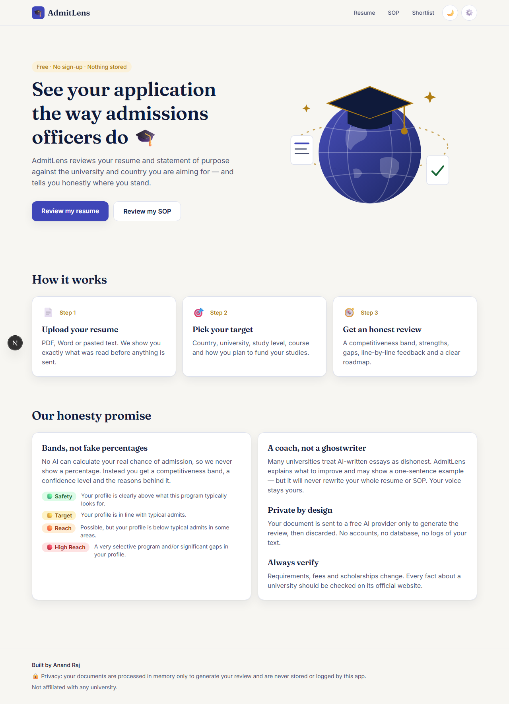
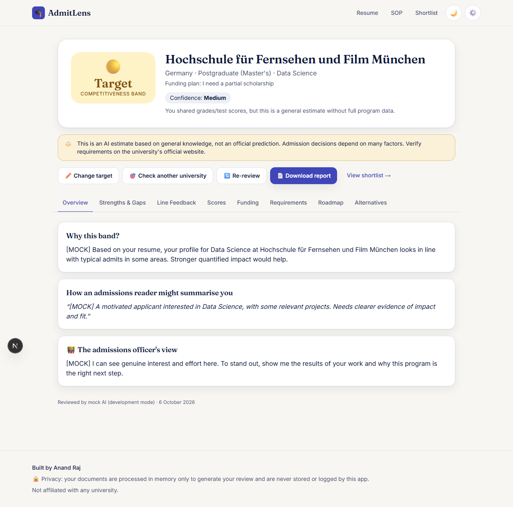
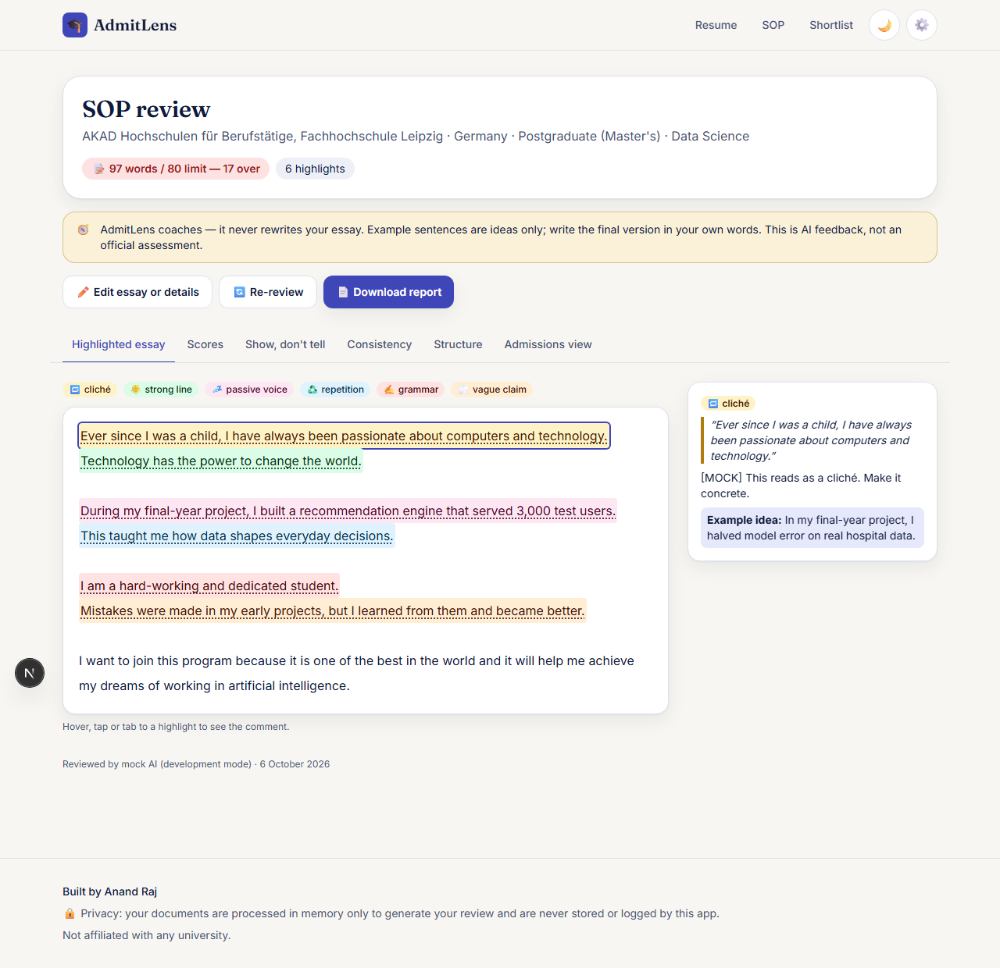

# AdmitLens 🎓 — AI Resume & SOP Reviewer

**See your application the way admissions officers do.**
AdmitLens reviews a student's resume against a target country, university, study level, course and funding plan, and gives an honest **competitiveness band** — never a fake percentage. A second tab coaches students on their SOP / personal statement.

Free AI only (Google Gemini + Groq), no database, no login.




<!-- Screenshots from mock mode — replace with your own anytime -->

## Features
- **Resume review wizard** (8 steps): upload PDF / Word / pasted text → country (21 popular destinations first, flags, search) → university (≈10,000 universities from an open dataset, searchable) → study level → funding plan → course → optional academic details → summary.
- **Results**: band badge + confidence level, strengths, gaps, line-by-line feedback, score radar chart, funding reality, typical requirements, roadmap, alternative universities.
- **Shortlist comparison** of every university you checked (saved in your browser — results only).
- **Download report** (print → Save as PDF).
- **SOP reviewer**: colour-coded highlights (cliché, vague claim, tell-don't-show…), word count vs. limit, show-don't-tell, paragraph feedback, and a resume ↔ SOP consistency check.
- Light/dark mode, mobile-first (360px+), keyboard accessible.

## Honesty principles
1. **Bands, not percentages.** No AI can calculate a real admission chance. Output is validated so no probability field — or "70% chance" text — can get through.
2. **Coach, don't ghostwrite.** The AI never rewrites a whole resume or essay; at most a one-sentence example.
3. **Privacy first.** Documents are processed in memory and discarded. Never stored, never logged.
4. **Verify on the official site.** Requirements, fees and scholarships change.

## Setup (Windows, beginner friendly)
1. Install **Node.js 22 LTS or newer** from https://nodejs.org.
2. Open the project folder in VS Code → **Terminal → New Terminal**.
3. Run `npm install` (if PowerShell blocks it, use `npm.cmd install` — same for every command below).
4. Add your keys to `.env.local` (see below).
5. Run `npm run dev` and open http://localhost:3000.

### Getting free API keys
- **Gemini (main AI):** go to https://aistudio.google.com/app/apikey → sign in with Google → **Create API key** → copy it.
- **Groq (backup AI):** go to https://console.groq.com/keys → sign up → **Create API Key** → copy it.

### Environment variables (`.env.local`)
| Variable | What it is |
|---|---|
| `GEMINI_API_KEY` | Your Gemini key (primary AI; reads PDFs directly) |
| `GROQ_API_KEY` | Your Groq key (fallback AI; text only) |
| `MOCK_AI` | `true` = fake answers for development, no AI used. Ignored in production. Keep `false` normally. |

Users can also paste their own Gemini key in **⚙️ Settings** — it is stored only in their browser.

Model names live in one file: `src/config/ai.ts`.

## Scripts
| Command | Does |
|---|---|
| `npm run dev` | Start the app locally |
| `npm run build` / `npm start` | Production build / run |
| `npm test` | Unit tests (Vitest) |
| `npm run typecheck` / `npm run lint` | Type and lint checks |
| `npm run check` | All of the above |
| `npm run data:universities` | Re-download and split the university dataset ([Hipo/university-domains-list](https://github.com/Hipo/university-domains-list)) |

## Deploying to Vercel (free)
1. Push the project to a GitHub repository (`.env.local` is git-ignored — never commit it).
2. On https://vercel.com → **Add New → Project** → import the repo.
3. In **Settings → Environment Variables**, add `GEMINI_API_KEY` and `GROQ_API_KEY` (don't add `MOCK_AI`).
4. Click **Deploy**.

Notes:
- AI routes set `maxDuration = 120` seconds (allowed on the Hobby plan because `vercel.json` enables Fluid compute, which allows up to 300 s).
- Vercel limits request bodies to ~4.5 MB, so uploads are capped at 3 MB (set in `src/config/limits.ts`).
- **Rate limiting** (15 reviews/hour per IP) is in memory and therefore **best-effort on serverless**: each instance keeps its own count and resets on cold start. Use a shared store (e.g. Upstash Redis) for strict limits.

## Project structure
```
src/app        pages + API routes (/api/review, /api/sop)
src/components UI (wizard, results, SOP, comboboxes…)
src/lib        schemas (Zod), prompts, AI runner/providers/mock, extraction, storage
src/config     AI models, bands, countries, limits
scripts/       dataset + pdf.js worker scripts
tests/         Vitest tests + fake fixtures
```

Built by Anand Raj · Not affiliated with any university.
